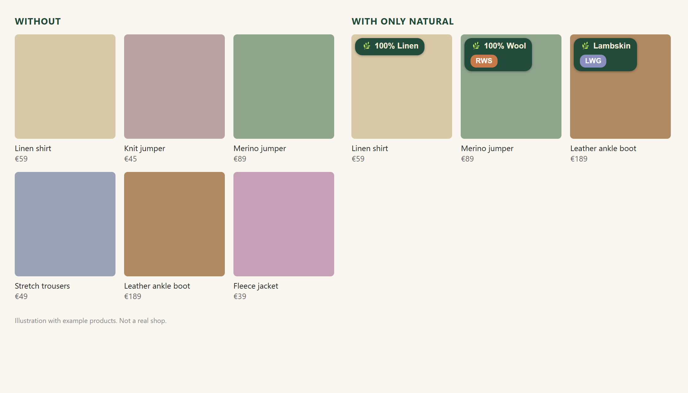
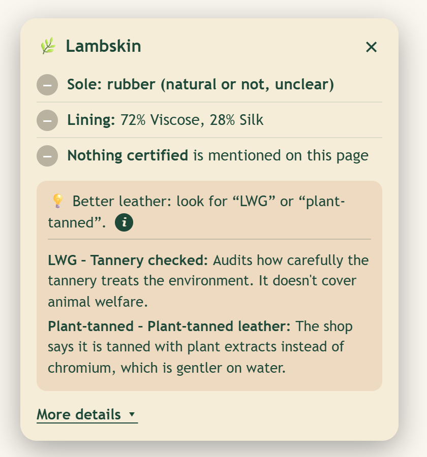

# Only Natural

**Shop for natural materials without opening a single product page.**
A browser extension (Chrome, Edge and Firefox) that shows only clothing made from natural-origin materials, with a short label and plain-language certification info.

**At a glance**
- **Problem:** choosing materials online takes expert knowledge and endless clicking, and most shops don't make it easy.
- **What I did:** defined the user need and the decision rules, tested on real shops, and built the prototype with AI tools (Claude Code).
- **What I learned:** a rule nobody adopts changes nothing. Every design choice was a trade-off between being strict and being used.

*A prototype by a sustainability and technology-governance professional. I defined the problem, the rules and the trade-offs; the AI wrote the code.*

---

## The problem

> "I need to confess something. I love fashion and shopping. Working in sustainability, this has been my big dilemma. How can I be sustainable and stay fashionable?"

In sustainability and technology topics, the same pattern keeps appearing: **the information exists, but it is too hard to use at the moment of decision.** People who want to choose well are not stopped by a lack of motivation, but by effort and expertise. Shopping for clothes is a clear everyday example:

- **High effort, expert knowledge.** To choose sustainable materials you have to know which ones they are *and* select them one by one. Big shops at least have a material filter; smaller shops often have none.
- **Information is technically there, but not usable.** Filters show "50% wool, 50% acrylic" as a wool item, so you click, check, go back, and repeat. Online shopping is supposed to save time. This doesn't.
- **Friction is highest on the phone,** where many people shop and where checking every product is even more tedious. (The extension itself runs in desktop browsers for now.)
- **No incentive for shops to be transparent.** Many shops do not disclose certifications or complete material details, and shoppers have no easy way to see it.

This is a small version of a bigger question I care about professionally: **how do you turn a good intention into an easy default, so that people change behaviour without needing to become experts?** This project is my test case. I defined the user need, the decision rules and the trade-offs, and built a working prototype with AI tools to see whether the idea holds up in the real world.

## What it does

Switch it on and the list page shows only items made purely from natural-origin materials. Items with plastic-based fibres, or whose materials can't be read, are hidden.

- **A short green label** on each item shows the composition, e.g. "Lambskin" or "100% linen".
- **A small card** opens on click, with independently audited certifications (✓), what the shop only claims, and one practical tip.
- **An "i" button** explains terms such as "plant-tanned leather" in plain words.

- **Plain language, 10 languages**, following the browser's language.
- **Works only on shopping sites, list pages and clothing**, with an off switch per site.
- **No account, no tracking.** Everything runs in your browser.

You don't need any expert knowledge to use it. You learn while you shop.

## My approach

Sustainable consumption has several levers: buy less, buy secondhand, choose durability over trends, choose good materials, care for them, and prefer single-material items that can be recycled.

I follow one of them, **material choice**, because that is what makes me wear a garment the longest, trends aside. This is a filter for **wearing things long and often**, not a complete sustainability solution.

## Decisions I made (and why)

**1. "Natural" is not automatically "better", so the label never stands alone.**
How a fibre is produced matters: conventional cotton is water- and pesticide-intensive, leather and cashmere have large footprints, and viscose is chemically processed. A filter that only says "natural" would quietly promise more than it can keep. So the tool shows **certification labels** next to the material and separates what is independently audited (✓) from what the shop merely says. *Trade-off:* the label is a little busier, and shops without certificates look worse. I accept that, because it is true, and it shows how little many shops disclose.

**2. Categories differ. Shoes and accessories almost always contain some plastic.**
One rule for everything would have hidden nearly every shoe. So I decided per part, by asking where the material matters most to the wearer:
- **Soles: plastic hides the shoe, natural passes, plain rubber passes with a note on the card only.** A leather sole on every shoe would be too expensive, and it is often unclear whether rubber is plant-based or synthetic. This is a deliberate user-experience compromise. I kept the note off the label so the label stays short and elegant.
- **Linings: strict.** Linings sit against the skin. A linen garment for summer with a non-breathable lining defeats the purpose of wearing linen. Natural linings (cotton, viscose, silk, leather) are common enough that a strict rule is realistic.
- **The label shows the outer material, the card shows the lining,** and the verdict stays strict on the lining. A lining-only reading (e.g. "72% viscose, 28% silk" for a coat) must not be mistaken for the whole garment.
- **Metal hardware (zips, buckles) is not judged.** Metal is not the target of this tool, and judging it would add noise without helping the wearer.

**3. Acetate and triacetate count as natural-origin, with an honest note.** They are made from wood pulp, so they are not petroleum-based, but they are chemically processed. I included them because they are common linings, and the card explains the processing in plain language so users can decide for themselves.

**4. It does not show a carbon footprint.**
I considered adding a footprint score. I decided against it for three reasons. Product pages don't contain the data (origin, energy, dyeing, shipping, garment weight). Published fibre figures vary so much that many fibres could not be placed in one band honestly. And an invented number would look more precise than it is, which is greenwashing in reverse. I would add an estimate only if independent sources agreed on a ranking. I'd rather be useful than look precise.

**5. When the page is unclear, the item is hidden, and there is a switch for it.**
"Strict" is the default: if the material cannot be read, the item is hidden, because the promise of the tool is "everything you see is natural". Users who prefer to see unclear items too can switch strict mode off. The cost is that some good items are missing. I chose to miss good items rather than to show wrong ones.

**6. The tool never works around a shop's protection.**
When a shop blocks the extension, it pauses and says so in the bubble, instead of hiding what it could not check or trying to get around the block. A tool about responsible shopping should act responsibly itself.

**7. The values are mine, and I say so.**
I prefer 100% modal over 80% modal + 20% polyamide because of comfort and feel, so I filter out blends. That is a value judgment, not a neutral fact. Some people wear nylon blends for longer because they are tougher, and a longer life can mean a lower footprint. I follow the lever that makes me wear things longest, which is material choice. Someone with other priorities, such as recyclability or the lowest carbon, might choose differently. The tool reflects my preference openly and does not claim to be neutral.

## Who it's for

- Everyday shoppers at **affordable shops (e.g. H&M)** who want good materials without reading every label.
- Shoppers at **premium and luxury shops (e.g. Mytheresa)** who want to be sure a high price is matched by good material.

## Stakeholders and trade-offs

Like any change, this tool touches several groups with different interests. Most design decisions were really about balancing them:

| Who | What they need | How the tool responds |
| --- | --- | --- |
| **Shoppers** | A quick answer without expert knowledge | One short label, details only on request |
| **Shoppers with other values** (vegan, budget, durability over origin) | Their priorities respected | The tool states that its rule is my value judgment; strict mode can be switched off; a vegan setting is an idea for later |
| **Shops** | Fair treatment, no disruption | The tool only opens the shop's own product pages from your browser, pauses when a shop restricts access, and never works around protections. Missing information is shown plainly, which can motivate more transparency |
| **Certification bodies** | Their labels shown accurately | Independently audited labels are kept apart from what a shop only claims, and the card explains what each label does *not* cover |
| **Me, as designer** | A tool I would actually use | My preferences are the starting point, and I say so openly |

The sole decision shows the pattern. Insisting on leather soles would be the purest rule, but too expensive for most shoppers, so most would switch the tool off. Accepting plain rubber with a note keeps people using it. **A rule nobody adopts changes nothing**, which is the same lesson as in organisational change.

## What it makes visible

Not every shop discloses certifications or full material details. The tool shows this plainly (no label, no certification). That can nudge shops to be more transparent.

## Why this matters beyond shopping

The project is a small case of a bigger skill: **bridging technical complexity and everyday decisions.**

- **The data is messy.** Material information comes in many formats, languages and levels of detail.
- **I turned it into something people can use:** one short, plain label, and an optional "i" for those who want more.
- **I designed for different users:** the person who wants a quick answer, and the person who wants detail.
- **I made trade-offs openly:** strict on linings, flexible on soles with a note, and clear about what the tool does not judge.

My method, which I would apply to any change: **understand the user, simplify, test in the real world, explain the limits.**

**The business mechanism, in short.** I have not measured any commercial effect, so I don't claim one. The logic is this: vague sustainability claims carry greenwashing and reputational risk for brands, while clear and trustworthy information builds customer trust. And inside organisations, a change that is explained simply and honestly meets less resistance. Making complexity easy is what turns a good idea into something people adopt.

## Where it works

I ran an automated check on fashion shops across Europe, the US, Asia, Latin America and the Middle East, and on a few non-clothing pages (cosmetics, electronics, cushions), using a fresh Chromium browser.

| Result | Count |
| --- | --- |
| **Shops where it worked** (product tiles found, materials read, list filtered) | 63 |
| **Non-clothing pages left untouched** | 5 of 5 |

On those 63 shops, it kept 379 of 1,431 tested products.

**Worked:** Zara, H&M, Monki, Gap, Old Navy, Banana Republic, Primark, Abercrombie & Fitch, American Eagle, ASOS, Uniqlo (US, JP), Next, Marks & Spencer, John Lewis, River Island, PrettyLittleThing, Matalan, Boohoo, Liberty London, Hush, Boden, Finisterre, Bonprix, Peek & Cloppenburg, Breuninger, Vestiaire Collective, OVS, Desigual, Springfield, Lindex, NA-KD, Filippa K, Acne Studios, Ganni, Vero Moda, Jack & Jones, Mytheresa, Hugo Boss, Lacoste, Nike, Lululemon, Puma, Eileen Fisher, Organic Basics, Reformation, Asket, Free People, Anthropologie, Urban Outfitters, Aritzia, Depop, eBay (UK), Poshmark, Myntra, Musinsa, The Iconic, Cotton On, Lazada, Trendyol, Hepsiburada, Dafiti, Namshi.

**Not confirmed:** the other shops I tried refused access, froze or showed no product tiles. That could be bot protection against my test browser, a test page that is not a product list, or a limit of the extension. I have not investigated each one, so this is *not* proof that they fail for a normal shopper. Max Mara, Noon and Intrend, for example, worked in separate checks.

## Limits

- It is a **materials filter, not a sustainability rating.** It can't judge production, transport, dyeing, working conditions or how much you buy.
- **Natural-origin does not always mean low-impact.**
- It reads what the shop's page says. If a page is wrong or incomplete, the result is too.
- Shops change their pages, so some will stop working over time.
- **Shops with bot protection.** Some shops restrict access when they see many quick requests. If a shop refuses three requests, the extension pauses for 10 minutes, leaves the page untouched and says so in the bubble. It does not try to get around such protections.
- **Tiles without product links.** Some shops draw products that are not real links, so there is no product page to read. Those shops will not work, except where I added a special case.
- **Shops that reuse their tiles.** On some pages, hiding one product makes the list move. The extension then hides tiles by making them invisible, which can leave blank spaces. Big photo carousels without product links cannot be labelled.
- Translations were written by me with AI help and haven't been reviewed by native speakers.
- The most important rule isn't in the tool: **wear things for a long time and take care of them.** Even low-footprint items are still consumption.

## Install (developer mode)

1. Download or clone this folder.
2. Open `chrome://extensions` (or `edge://extensions`) and switch on **Developer mode**.
3. Click **Load unpacked** and select the folder.
4. Open a clothing list page on any shop and click the extension icon to switch it on.

### Firefox

The same folder works in Firefox 128 or newer.

1. Open `about:debugging#/runtime/this-firefox`.
2. Click **Load Temporary Add-on** and select the `manifest.json` in this folder.
3. When asked, allow the extension on all websites (Firefox: *Manage Extension → Permissions*). Without that permission it cannot read product pages.

A temporary add-on is removed when Firefox closes. For a permanent install it has to be signed through addons.mozilla.org. Firefox support is new and only lightly tested, so Chrome and Edge remain the main tested browsers.

### Something not working?

Click the extension icon on the problem page and use **Something wrong? Copy report**. It copies counts and shapes of the page (the address without its query part, how many products were found, how often the page changed, whether tiles flipped between states). It contains no page text, product names, prices or personal data. Paste it into an issue.

## How it works (short)

The extension reads the materials from each product page, in the background. It understands percentages, main fabric vs lining, word-only lists ("upper: calf leather; lining: lambskin"), certification words and soles. Then it hides or labels each item. Texts are written in 10 languages.

## What could be next

Ideas only, nothing is promised:

- Review of the translations by native speakers
- An optional "vegan" setting for people who also want to avoid leather, wool and silk
- Handling of coated or printed materials (e.g. a polyurethane coating)
- A phone version, since many people shop on their phone
- A gentle "will you wear this 30 times?" reminder on the card
- A footprint estimate, **only if** two independent sources agree on a ranking

## Credits and sources

Certification descriptions are based on the standards' own public information. Material knowledge is summarised in plain language and may simplify.

## Licence

[MIT](LICENSE). Free to use, change and share, as long as the copyright notice stays. Provided as is, without warranty: material readings can be wrong, so check the shop's own product page before relying on a result.
